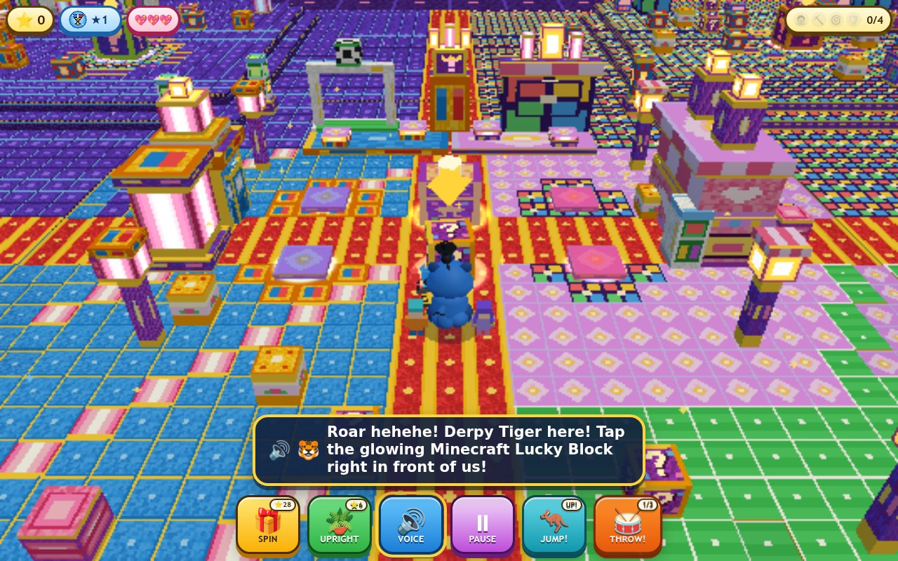

# Derpy Tiger Minecraft Chapter 3D (`derpy-tiger-minecraft-3d`, Game #63)

- **Live Game**: [https://kunruiw1991.github.io/derpy-tiger-minecraft-3d/](https://kunruiw1991.github.io/derpy-tiger-minecraft-3d/)
- **Inspired By**: [Derpy Tiger Minecraft Chapter Animation (YouTube `EgruEB4oZ2E`)](https://www.youtube.com/watch?v=EgruEB4oZ2E) & [Minecraft Chapter Gameplay Reference (YouTube `WjAyI6kwylA`)](https://www.youtube.com/watch?v=WjAyI6kwylA)



A kid-friendly, zero-build Three.js r170 WebGL2 3D adventure game starring **Derpy Tiger** (the chubby blue Korean Minhwa folk-art tiger with his signature round face and twin round butt cheeks `buttL` / `buttR`), **Sussie the Six-Eyed Magpie**, **Rumi**, and **Voxel Mikey** across a 5-zone `72x72` Voxel Minecraft Chapter map!

## Key Features
- **Derpy Tiger 3D Character Rig (`src/chars/hero.js`)**:
  - **Round Face (`head`)**: `SphereGeometry(0.48, 36, 28)` with widened lower cheeks (`x *= 1.18`), flattened front facial plane, wide cream `muzzleMask`, golden saucer `eyes` (`#ffd026`) with cross-eyed pupils, flat pink `nose`, wide `derpyGoofyGrin` with 12 fangs + curled pink `tongue`, and royal `"WANG"` (`wangForeheadMark`) forehead stripes.
  - **Round Butt & Pear Torso (`torso`, `derpyRoundButt`, `buttL`, `buttR`)**: Pear-shaped `bodyLoft` lathe torso widening at the hips (`r = 0.45`), cream belly, twin sculpted round butt cheeks (`buttL` and `buttR` `SphereGeometry(0.225, 24, 18)` at `(±0.175, -0.24, -0.22)` scaled `(1.08, 0.98, 1.16)` with curved tiger stripes and waddle/jump bounce), stocky cobalt haunches, 4 paws with pink toe beans, and 9-ringed curling `tail`.
  - **Hero Squad Companions**: Sussie the Six-Eyed Magpie in a miniature black Korean Gat hat (`sussieMagpie`), Rumi with twin purple dragon braids (`mikeyGroup`, `leftBraid`, `rightBraid`), and Voxel Minecraft Mikey (`sahurGroup`).
- **5-Zone `72x72` Voxel Minecraft Chapter Map (`src/world/island.js`, `src/world/blocks.js`)**:
  1. **Central Hub**: Moonlit Rooftop Portal Terrace & White Iron Security House with Glowing Cyan Honmoon Floor Portal, Diamond Safe Lucky Chest (`#btn-hud-spin`), and **4 Tipped-to-Upright Blue-and-White Porcelain Peony Flowerpots** (`#btn-hud-pot` / `#btn-hud-totem`).
  2. **Q1 (NW — Village Rooftops & Buried Cookie Garden)**: Terracotta village roofs, brick chimneys, and *Rumi's Bouncy Zombie Captain* (`zombie_captain`).
  3. **Q2 (NE — Underground Drill Tunnel & Carrot Farm)**: Stone-brick mine tunnel, village well, torchlit carrot rows, and *Drill Golem Mole* (`drill_golem`).
  4. **Q3 (SW — Red Laser Security House & Closet Portal)**: White iron security walls, red laser beams, CCTV towers, Rumi's bedroom closet portal loft, and *Closet Prankster Puppet* (`closet_puppet`).
  5. **Q4 (SE — Lava Parkour Vault & HUNTR/X Comeback Stage)**: Magma stepping stones, passcode `1-2-3-4` keypad, Mikey iron-bar rescue cage, Jinu's dark stone stairs (`"SAVE THE DATE"` card), pink `HUNTR/X COMEBACK` billboard, and *Giant Long-Arm Security Boss* (`security_boss`).
- **Mario-Style 3D Jump (`#btn-hud-jump` / `Space`) & Super Mario Odyssey Returning Throw (`#btn-hud-drum` / `Enter`)**:
  - Snappy 3D jump physics (`vy = 11.5`, asymmetric gravity `28.0` up / `38.0` down), overhead crate head-bonk (`HEAD BONK!`), and mid-air Jump-to-Throw combo.
  - 3-phase returning projectile throw (`outbound` -> `hover` -> `returning` over `6.2` units) that smashes blocks, bonks bosses, pats critters, and vacuums gems.
- **68 Pre-Recorded Neural English `edge-tts` MP3 Voiceovers (`assets/voice/*.mp3`)**:
  - 68 high-clarity English MP3 voice clips (`44.1 kHz` mono `64 kbps`) decoded via WebAudio with `-6 dB` BGM ducking, `#btn-hud-voice` replay, and interactive subtitle banner (`#voice-subtitle`).

## Automated QA Verification
- `python3 -P tools/gen_voice.py --check` — Validates all 68 `edge-tts` MP3 voiceover clips via `ffprobe`.
- `python3 -P tests/l10n_audit.py` — Gate F13 static + runtime 100%-English (`0` CJK) and `0` `speechSynthesis` audit.
- `python3 -P tests/layout_audit.py` — Gate F11 5-viewport responsive layout and touch-target audit.
- `python3 -P tests/sim_gates.py` — Gates F1–F12 gameplay physics, Mario 3D Jump, Odyssey returning throw, and 20-seed bot simulation.
- `python3 -P tests/run_e2e.py` — E01–E50 master E2E verification suite.
- `python3 -P tests/run_all_tiers.py --all` — Full 4-tier verification suite across Features F1–F11.

## Running Locally
Serve the repository root over HTTP:
```bash
python3 -m http.server 8080
```
Then open [http://127.0.0.1:8080](http://127.0.0.1:8080) in Chrome.
